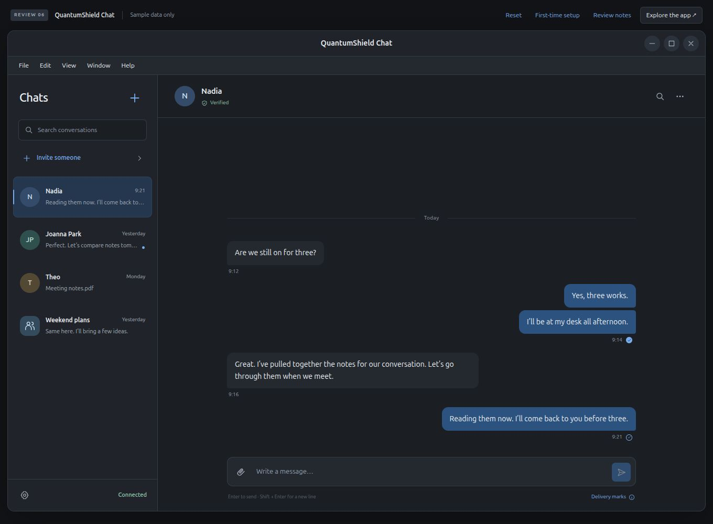

# QuantumShield Labs

## Privacy for the message. And its journey.

We’re building **QuantumShield Chat**: hybrid post-quantum messaging, a locally controlled vault and **planned Katzenpost (KP) transport** in one understandable experience.

[Explore the app preview](https://quantumshieldlabs.org/preview) · [Read the November update](https://github.com/QuantumShieldLabs/qsl-protocol/blob/main/docs/public/PROJECT_STATUS_2026-11.md) · [Examine the research](https://github.com/QuantumShieldLabs/qsl-protocol/blob/main/docs/public/INDEX.md)

*Interface preview v6. Sample data only. Messaging, identity verification and the KP connection are simulated; this image is not a working release.*

**Research stage. Not independently audited or production-ready. The public desktop prototype does not yet send or receive messages. Do not use QSL for safety-critical communications.**

## Why QSL + KP?

Message content and communication patterns are different privacy problems. Our intended composition keeps QSL’s end-to-end encryption inside Katzenpost’s encrypted mix-network transport.

- **Protect the message:** QSL’s Suite-2 is a research-stage Triple-Ratchet-style hybrid messaging design, combining classical and post-quantum key material.
- **Handle state carefully:** explicit persistence, retry and refusal rules aim to keep crashes, tampering and recovery from becoming silent failures.
- **Reduce the trail:** KP’s mixing, delays and cover traffic address traffic-pattern exposure. We still need to validate the real composition, measure its costs and state its limits.

KP is our intended transport direction and lead integration candidate. It is an independent project; this is not an announcement of a partnership, endorsement or completed integration. QSL does not currently establish anonymity or resistance to global traffic analysis. Read [Katzenpost’s documentation](https://katzenpost.network/docs/) and QSL’s [claim boundary](https://github.com/QuantumShieldLabs/qsl-protocol/blob/main/docs/public/SUITE2_TRIPLE_RATCHET_CLAIM_BOUNDARY.md).

## Where we are · November 2026

| Area | Current position |
|---|---|
| Encrypted local state | Focused development checks covered encrypted private storage, send-and-reopen behavior, tamper refusal and sensitive-output redaction. |
| Guarded deletion | Core-path checks covered exact confirmation, a waiting period, cancellation and removal of the intended unreadable-vault file. |
| Complete vault | Composition, full validation, platform coverage and required review remain open. |
| Real QSL/KP exchange | Next integration proof after the vault and necessary application prerequisites. |
| Desktop experience | Public prototype and a separate v6 interface preview; ordinary desktop messaging remains unfinished. |

These are **maintainer-reported development results**, not a claim that every change is published on the default branches. The [dated update](https://github.com/QuantumShieldLabs/qsl-protocol/blob/main/docs/public/PROJECT_STATUS_2026-11.md) distinguishes current source, development progress and future work. Tests of a bounded path do not qualify the whole application.

## Explore the project

| Repository | Start here if you want to… |
|---|---|
| [qsl-protocol](https://github.com/QuantumShieldLabs/qsl-protocol) | Read the specifications, inspect vectors and review the client core. |
| [qsl-desktop](https://github.com/QuantumShieldLabs/qsl-desktop) | Explore the Tauri prototype, current feature limits and intended interface. |
| [qsl-server](https://github.com/QuantumShieldLabs/qsl-server) | Understand the existing relay’s mailbox, invitation and operational boundaries. |
| [qsl-attachments](https://github.com/QuantumShieldLabs/qsl-attachments) | Inspect the separate encrypted-object service and its storage contract. |

## Help make the evidence stronger

We welcome cryptographic review, reproducible failures, missing negative cases, independent implementations and accessibility feedback on the preview. Start with the affected repository’s contribution guide and include the revision and scope of your observation.

For a security-sensitive finding, follow its `SECURITY.md` and use private reporting. Keep exploit details and personal data out of public issues.

The [design vocabulary](https://github.com/QuantumShieldLabs/qsl-protocol/blob/main/docs/public/QSL_VOCABULARY.md) explains Contact Capsule, Key Continuity, Commit Path and Quiet Transit. These labels describe research; they do not establish security guarantees.

Each repository’s license controls its source. The four code repositories identify their license as `AGPL-3.0-only`.
